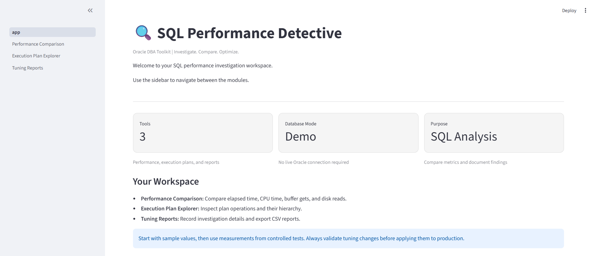
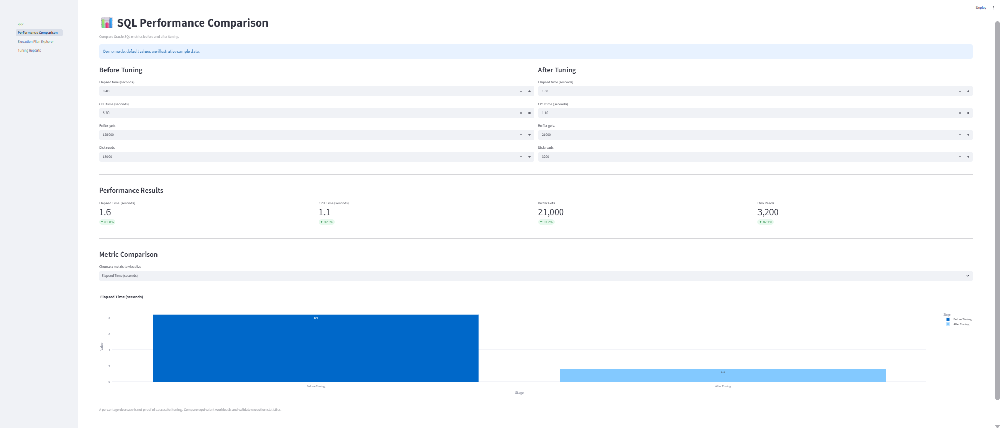
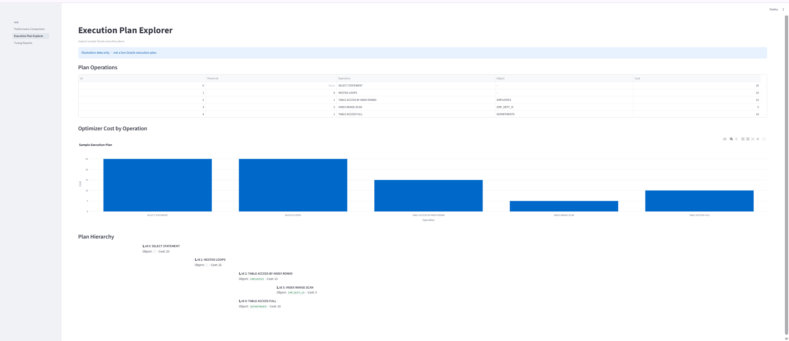

# SQL Performance Detective

A Python-based Oracle DBA learning project for comparing SQL performance metrics, exploring execution plans, and documenting tuning investigations.

## Features

- **Performance Comparison:** Compare elapsed time, CPU time, buffer gets, and disk reads before and after tuning.
- **Execution Plan Explorer:** View sample Oracle execution-plan operations, estimated costs, and hierarchy.
- **Tuning Reports:** Record investigation details and export performance comparisons to CSV.
- **Interactive Dashboard:** Navigate between modules through Streamlit.

## Technology Stack

- Python
- Streamlit
- Pandas
- Plotly

## Project Structure

```text
SQL-Performance-Detective/
├── app.py
├── app_backup.py
├── README.md
└── pages/
    ├── 1_Performance_Comparison.py
    ├── 2_Execution_Plan_Explorer.py
    └── 3_Tuning_Reports.py
```

## Setup

1. Create and activate a Python virtual environment.
2. Install dependencies:

   ```bash
   pip install streamlit pandas plotly
   ```

3. Start the application:

   ```bash
   streamlit run app.py
   ```

## Current Limitations

- Uses sample execution-plan data by default.
- Does not connect to a live Oracle database.
- Plan analysis and hierarchy are demonstrations, not a complete Oracle execution-plan parser.
- Tuning recommendations require validation using actual execution statistics and comparable test conditions.

## Future Improvements

- Parse real `DBMS_XPLAN` output.
- Add optional Oracle database integration.
- Compare actual execution statistics.
- Improve execution-plan visualization.
- Add automated, evidence-based tuning observations.

## Purpose

This project is intended for learning Oracle SQL performance concepts and demonstrating Python application development.


## Screenshots

### Dashboard


### Performance Comparison


### Execution Plan Explorer

